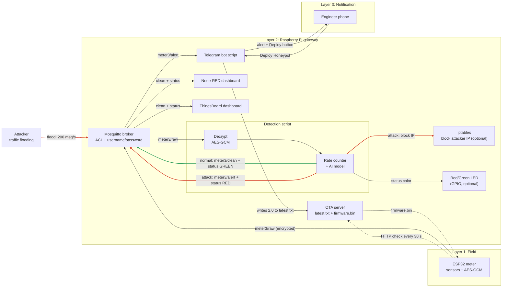

# Architecture

The Edge-Deception Gateway sits between ESP32 smart meters and the cloud. A Raspberry Pi detects attacks locally, isolates the attacker, and switches the compromised node into a honeypot over the air.

## System flow

## Components

| Component | Runs on | Role | Owner |
|---|---|---|---|
| ESP32 firmware | ESP32 | Reads sensors, publishes telemetry, checks for OTA updates | Anwar, Haneen |
| Mosquitto broker | Raspberry Pi | Passes MQTT messages between all parts | Doaa |
| Detection engine | Raspberry Pi | Rate counter and AI model, gate before the dashboard and cloud | Alaa |
| OTA server | Raspberry Pi | Serves `latest.txt` and `firmware.bin` over HTTP | Doaa, Haneen |
| Telegram bot | Raspberry Pi | Sends alerts and handles the Deploy button | Haneen |
| Node-RED dashboard | Raspberry Pi | Shows readings and the green/red status | Alaa |

## Phases

### Phase A: Normal operation

1. The ESP32 reads its sensors and publishes JSON to `meter3/raw`.
2. The detection engine checks each message. Normal messages are republished to `meter3/clean`.
3. The dashboard shows the readings and a green status.

### Phase B: Attack detection

1. The detection engine sees a flood (message rate above the threshold) or abnormal values (AI model).
2. It sets the status to `RED`, blocks the attacker's IP, and publishes to `meter3/alert`.
3. Suspicious messages never reach `clean`, so the dashboard and cloud only see trusted data.
4. The Telegram bot sends the alert to the security engineer's phone.

### Phase C: Honeypot deployment

1. The engineer presses **Deploy Honeypot** in Telegram. The bot checks the chat ID, then writes `2.0` to `latest.txt`.
2. On its next 30-second check, the ESP32 sees the higher version and downloads `firmware.bin` from the Pi.
3. The ESP32 flashes it, reboots, and runs the honeypot, which sends fake telemetry and logs unauthorized commands.

## Design decisions

- **Local OTA server:** the Pi serves the firmware over the local network (pull method), so devices need no internet and updates still work if the WAN is down.
- **AI as a gate:** only the detection engine reads `raw`, so the cloud never sees suspicious messages.
- **Human approval:** converting a meter into a honeypot stops its real work, so an engineer confirms it from the phone. Policy-based automatic mode is possible.
- **Plain HTTP for OTA:** acceptable for the prototype on a local network.

## Scaling and future work

- **More devices on one site:** add Wi-Fi access points on the same network, with one Pi serving all devices.
- **Many sites:** one Pi per site, with a central server that distributes firmware to the Pis (each Pi pulls from it).
- **Production security:** HTTPS, signed firmware, per-device certificates, secure boot, and rollback.
- **Long distances:** LoRa for telemetry, with firmware pre-loaded in advance and a short switch command during an attack.
