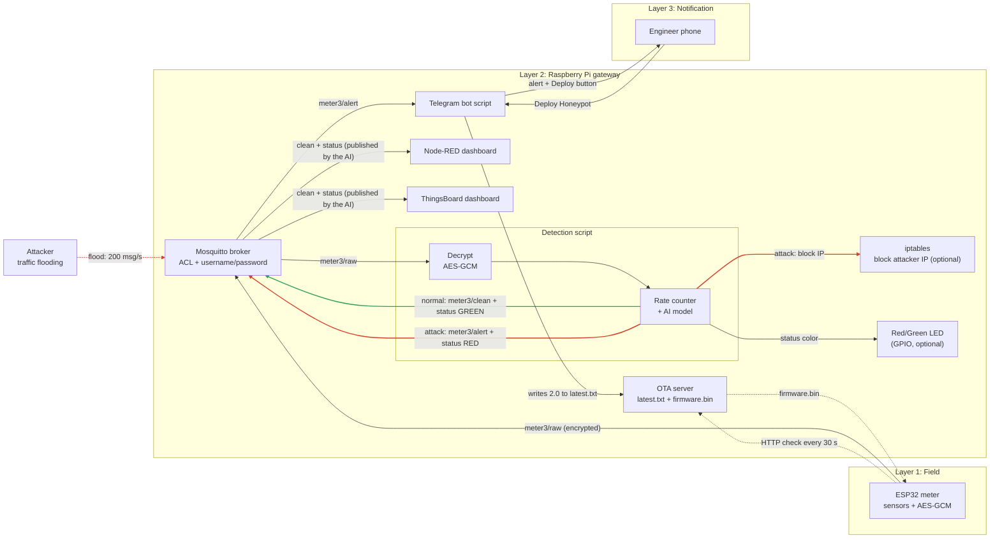

# Architecture

The Edge-Deception Gateway sits between ESP32 smart meters and the cloud. A Raspberry Pi detects attacks locally, isolates the attacker, and switches the compromised node into a honeypot over the air.

## System flow

## Components

| Component | Runs on | Role | Owner |
|---|---|---|---|
| ESP32 firmware | ESP32 | Reads sensors, publishes telemetry, checks for OTA updates | Anwar, Haneen |
| Mosquitto broker | Raspberry Pi | Passes MQTT messages between all parts | Doaa |
| Detection engine | Raspberry Pi | Rate counter and AI model, gate before the dashboard and cloud | Mona |
| OTA server | Raspberry Pi | Serves `latest.txt` and `firmware.bin` over HTTP | Doaa, Haneen |
| Telegram bot | Raspberry Pi | Sends alerts and handles the Deploy button | Haneen |
| Node-RED dashboard | Raspberry Pi | Shows readings and the green/red status | Mona |

## Phases

### Phase A: Normal operation

1. The ESP32 reads its sensors and publishes JSON to `edgeguard/v1/telemetry` over MQTT with TLS, every 5 seconds.
2. `MQTTToJson.py` saves each message to a JSONL log.
3. `DetectionScript.py` follows the log and checks each message: message rate, value ranges, and an Isolation Forest model.
4. Normal readings are pushed to Firebase (`/readings` and `/latest`).

### Phase B: Attack detection

1. The detector sees a flood (message rate above the threshold) or abnormal values (out of range, or flagged by the Isolation Forest).
2. It sends a Telegram alert to the security engineer with two buttons: **Deploy Honeypot** and **Ignore Attack**.
3. Suspicious readings never go to Firebase. Only an alert record without sensor data is stored (`/alerts`).

### Phase C: Honeypot deployment

1. The engineer presses **Deploy Honeypot**. The bot writes `1.1` to `CodeVersion.txt`.
2. On its next 30-second check, the ESP32 sees the newer version and downloads `firmwareV1_1.bin` from the local OTA server (HTTP, port 8080).
3. The ESP32 flashes it, reboots, and runs the honeypot. It serves a decoy admin login page on port 80 and publishes each request (IP, method, path) to `edgeguard/v1/honeypot/<device>`.
4. Pressing **Ignore Attack** writes `1.0`. The honeypot then downloads `firmwareV1_0.bin` and goes back to being a normal meter.

## Design decisions

- **Local OTA server:** firmware is served over the local network (pull method), so devices need no internet and updates still work if the WAN is down.
- **Detector as a gate:** only normal readings reach the cloud. During an attack the cloud gets an alert without data.
- **Human approval:** turning a meter into a honeypot stops its real work, so an engineer confirms it from the phone.
- **Encrypted, authenticated MQTT:** TLS 1.2, per-user passwords, and ACLs that limit which topics each user can read or write.
- **Plain HTTP for OTA:** acceptable for the prototype on a local network.

## Scaling and future work

- **Chat ID check:** make the bot ignore button presses from anyone except the engineer.
- **Automatic IP blocking:** block the attacker's IP on the Pi (for example with `iptables`) when an attack is detected.
- **Richer honeypot:** send fake telemetry and log attempted commands, not just web requests.
- **Payload encryption:** AES-GCM on each message, on top of TLS.
- **More devices on one site:** add Wi-Fi access points on the same network, with one Pi serving all devices.
- **Many sites:** one Pi per site, with a central server that distributes firmware to the Pis.
- **Production security:** HTTPS for OTA, signed firmware, per-device certificates, secure boot, and rollback.
- **Long distances:** LoRa for telemetry, with firmware pre-loaded in advance and a short switch command during an attack.
