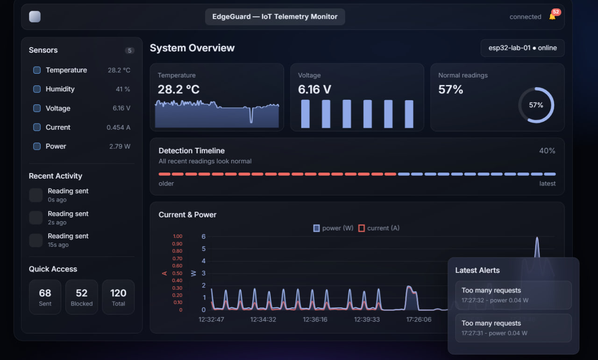
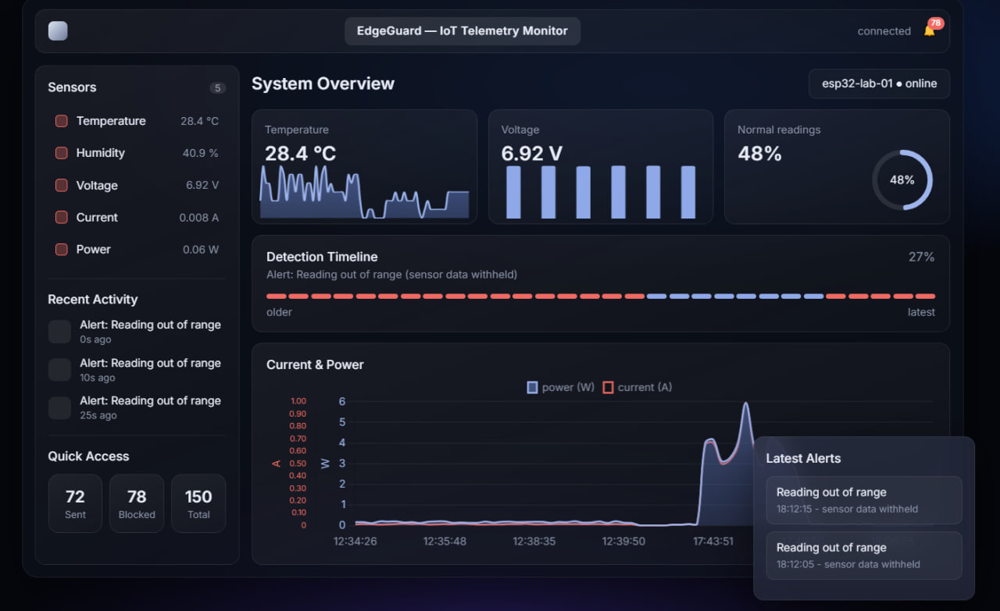
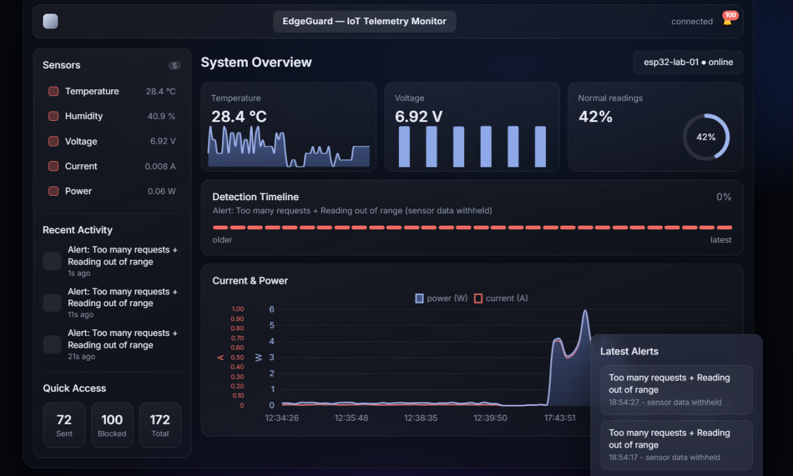

# EdgeGuard: IoT Telemetry Dashboard

A single-page, real-time web dashboard for the **Edge-Deception Gateway** project. It reads smart-meter telemetry and security alerts from a Firebase Realtime Database and shows them live: sensor values, detection timeline, charts, and the latest attack alerts.

No build step and no backend. It is one `index.html` file.
## Screenshots

| Normal operation | Out-of-range detected | Flood attack detected |
|---|---|---|
|  |  |  |

## Features

- **Live sensor panel**: temperature, humidity, voltage, current and power from the latest valid reading.
- **Detection timeline**: the last 30 events as a strip, red segments are blocked or alert events.
- **Normal-readings ring**: percentage of readings that passed the gateway checks.
- **Charts** (Chart.js): temperature trend, voltage bars, and current vs. power over time.
- **Latest alerts** with the reason, for example *Too many requests* or *Reading out of range*. Sensor data from an alerted reading is withheld and never plotted.
- **Counters**: sent, blocked and total readings, plus a notification badge.
- Updates instantly through Firebase `onValue` listeners, with no polling. Responsive layout for mobile.

## How it works

```
ESP32 / Gateway  ──writes──▶  Firebase Realtime Database  ──live updates──▶  this dashboard
```

The dashboard only **reads** from three paths:

| Path | Content |
|---|---|
| `/readings` | Last 120 telemetry readings |
| `/alerts` | Last 100 alerts (history) |
| `/latest_alert` | The most recent alert |

Each entry is a JSON object. A single object or a map of push-ID children both work.

**Reading**
```json
{ "ts": 1760000000000, "temperature": 31.5, "humidity": 48, "voltage": 220.4,
  "current": 0.015, "power": 3.3, "status": "OK" }
```
**Alert**
```json
{ "ts": 1760000000000, "too_many_requests": true, "out_of_range": false, "type": "RATE_LIMIT" }
```

- `ts` is a Unix timestamp in **milliseconds**.
- Readings with `status: "BLOCKED"` are ignored by the charts.
- The alert reason is built from `too_many_requests` and `out_of_range`, falling back to `type`.

## Setup

This repo does **not** include any Firebase credentials. You connect the dashboard to **your own** Firebase project (or ask the team owner for the shared config privately).

1. **Create a Firebase project** and enable **Realtime Database**.
2. In *Project settings ▸ Your apps ▸ Web app*, copy the config.
3. Create your local config file from the template and fill it in:
   ```bash
   cp firebase-config.example.js firebase-config.js     # Windows: copy firebase-config.example.js firebase-config.js
   ```
   `firebase-config.js` is git-ignored, so your keys are never committed.
4. Serve the folder (the config is loaded as an ES module, so opening the file directly with `file://` will not work):
   ```bash
   python -m http.server 8000     # then open http://localhost:8000
   ```
5. The status in the top bar shows `connected` once data is flowing. If it shows `error: ...`, check the database rules (see below).

## Deploy

Because `firebase-config.js` is git-ignored, GitHub Pages (which only serves committed files) will not work unless you commit your own config. Deploy from your machine instead:

- **Firebase Hosting**: run `firebase init hosting` in this folder, then `firebase deploy`. The local `firebase-config.js` is uploaded with the site.

## Security notes

- Never commit `firebase-config.js`, database exports (`*.json` dumps) or service-account keys (`*adminsdk*.json`).
- Even when kept out of the repo, the Firebase web config is visible to anyone who opens a deployed page. It is an identifier, not a secret. **Access control comes from your Realtime Database security rules**, so set them before publishing.
- Do **not** leave the database in *test mode* (open read and write, and it expires). The dashboard needs read access only. An example that allows public read on the three paths and writes only from authenticated devices:
  ```json
  {
    "rules": {
      "readings":     { ".read": true, ".write": "auth != null" },
      "alerts":       { ".read": true, ".write": "auth != null" },
      "latest_alert": { ".read": true, ".write": "auth != null" }
    }
  }
  ```
  Adapt `.write` to however your device authenticates.
- Optionally restrict the API key to your site's domain (*Google Cloud Console ▸ APIs & Services ▸ Credentials ▸ HTTP referrers*).
- Public read means anyone with the URL can see the telemetry. If that is not acceptable, require sign-in and change `.read` to `auth != null`.

## Tech stack

- Vanilla HTML, CSS and JavaScript (ES modules)
- [Firebase JS SDK](https://firebase.google.com/docs/web/setup) 10.12.2, Realtime Database (loaded from the CDN)
- [Chart.js](https://www.chartjs.org/) 4.4.1 (loaded from the CDN)
- Inter font via Google Fonts

An internet connection is needed to load the CDN assets.

## Project context

This dashboard is one part of the **Edge-Deception Gateway**: an edge gateway that detects flooding and DDoS attacks on industrial IoT nodes, isolates them, and switches them into honeypot mode. See the repository root for the other components (`esp32`, `pi`, `node-red`, `docs`).

## License

See the repository's `LICENSE` file.